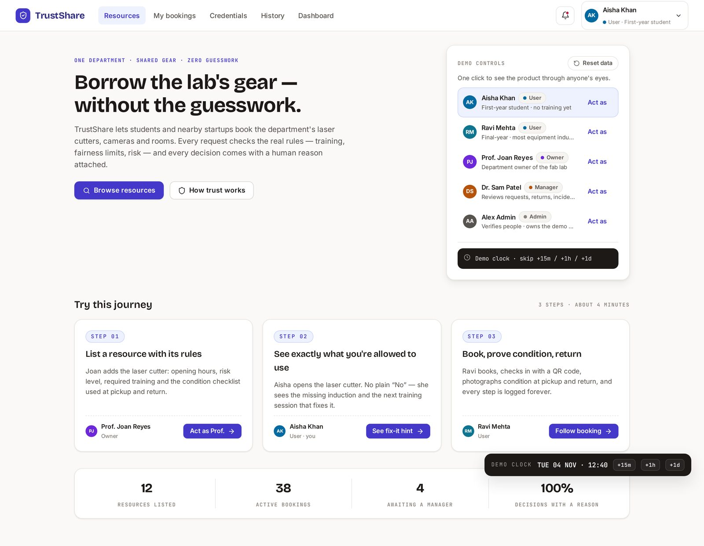
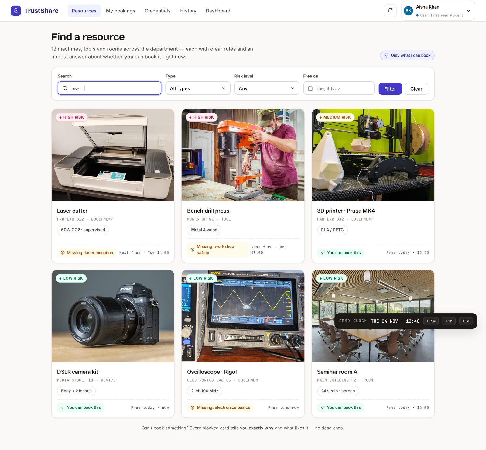
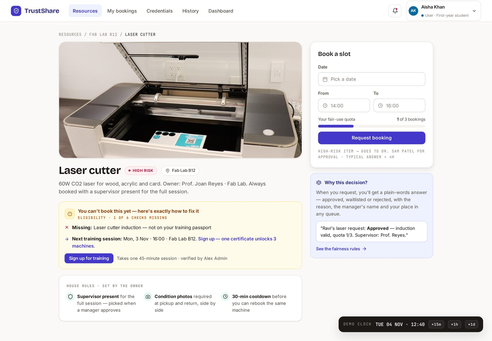
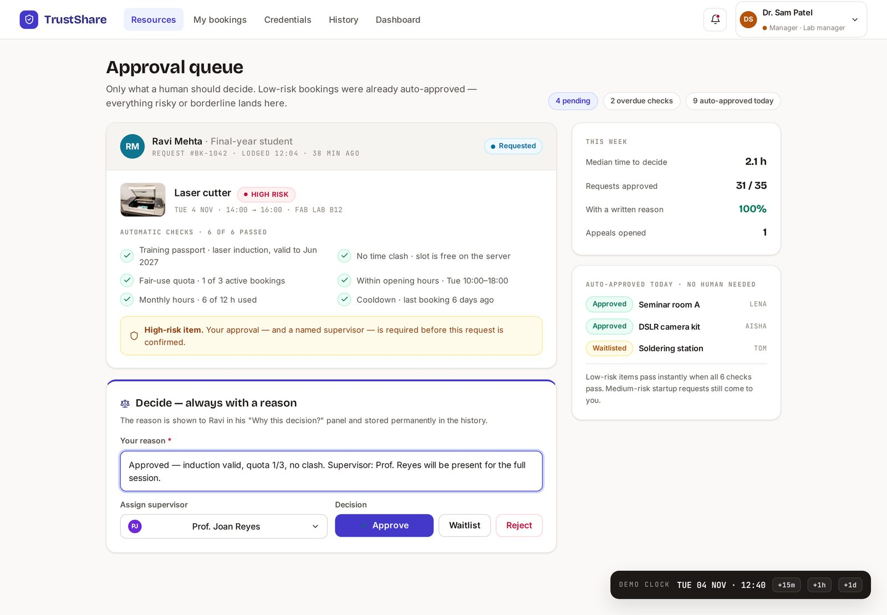
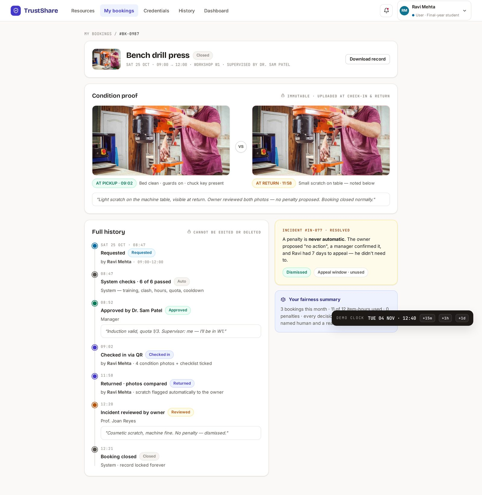
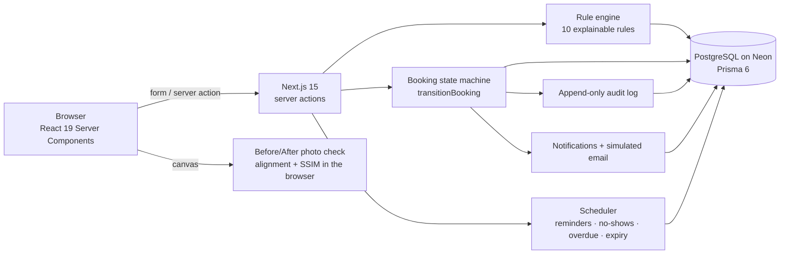

<div align="center">

# TrustShare

### Borrow the lab's gear without the guesswork.

**A trusted, fair and explainable way for a college engineering department to share its labs, equipment and rooms with students and nearby startups.**

[Live demo](https://YOUR-LIVE-LINK.vercel.app) · [Judge walkthrough](#-try-it-in-5-minutes-judge-walkthrough) · [Features](#-features) · [Architecture](#-architecture) · [Run locally](#-run-it-locally)

     

</div>

---

## The problem

Laser cutters, 3D printers, oscilloscopes, camera kits and seminar rooms sit idle most of the week, while the students and local startups who need them can't get access.

Today, sharing runs on WhatsApp messages, paper sign-up sheets and personal favours:

- **Staff can't tell who is trained**, so high-risk machines stay locked by default.
- **A few people take most of the slots**, and no-shows waste the rest.
- **Nobody can prove condition.** When something breaks, it's one person's word against another's.
- **Decisions are invisible.** People don't know why they were refused or what to do about it.

The result is wasted equipment budgets, stalled student projects, hours of manual approvals and damage disputes with no evidence.

## Our solution

TrustShare turns "can I borrow it?" into a clear, recorded and fair process:

1. **Owners list** equipment and spaces, with their own rules (risk level, required training, opening hours, quotas).
2. **Users see exactly what they're allowed to use** and, if not, what they are missing and how to fix it.
3. **Every request runs through 10 published rules.** Low-risk items are approved instantly; high-risk items go to a manager with every reason shown.
4. **Fairness is built in**: quotas, cooldowns, an active-booking cap, a published priority formula and a waitlist that promotes the next eligible person automatically.
5. **Condition is proven** with check-in and return checklists and photos, plus a **Before/After photo check** that highlights possible changes for a human to review.
6. **Problems are handled by people, not by the system**: incidents, penalties, appeals and disputes, all with written reasons.
7. **Everything is recorded** in an append-only history that both sides can see.

---

## Screenshots

> Replace with fresh screenshots of the live site if the UI changes.

| Judge "Start here" | Resource catalog |
|---|---|
|  |  |
| **Resource detail and eligibility** | **Manager approval queue** |
|  |  |
| **Condition proof and full history** | |
|  | |

---

## ✨ Features

### Discovery and eligibility
- **Resource catalog** with photos, search and filters (type, risk level, "only what I can book").
- **Eligibility at a glance.** Every resource page says "You can book this" or lists exactly what is missing (for example, "Laser cutter induction: next session Tuesday 3pm, Fab Lab B12").
- **Credential passport.** Users upload proof of training; managers verify or reject it with a note. Credentials expire and users are reminded before they do.

### The booking rule engine (explainable by design)
Every request is checked against 10 rules, and **each rule's result, detail and fix is stored with the booking and shown to the user**:

| # | Rule | If it fails |
|---|---|---|
| 1 | Required credentials, verified account, no active suspension | Reject, with how to fix it |
| 2 | Starts in the future | Reject |
| 3 | Inside opening hours on an open day | Reject |
| 4 | Booking length within the resource's maximum | Reject |
| 5 | Active-bookings cap (3 per person) | Reject |
| 6 | Monthly hours quota (minus any quota-reduction penalty) | Reject, with when it resets |
| 7 | Cooldown between bookings of the same resource | Reject, with the earliest date |
| 8 | Slot is free | Waitlist |
| 9 | Risk tier (high risk, or medium risk for external users) | Manager review |
| 10 | Supervisor required | Manager review |

Outcome: **auto-approve**, **manager review**, **waitlist** or **reject**, always with a plain-English reason.

### Fairness
- **Published priority formula:** +2 for your first booking of a resource, +1 if you've used less than half your monthly quota, −1 for each no-show or confirmed penalty in the last 30 days. Ties go to whoever asked first.
- **Waitlist with automatic promotion.** When a slot frees up (cancellation or no-show), the highest-priority waitlisted request is re-checked against every rule and approved or sent for review. Everyone still waiting is told their new position.
- **Quotas, cooldowns and caps** stop a few people from taking everything.

### Human decisions, always with a reason
- **Manager review queue** with the full rule breakdown, the requester's history and a required reason for every approve, reject or waitlist decision.
- **Supervisor assignment** for high-risk equipment.
- **Appeals** for rejected requests, **cancellations** with reasons, and managers can **revoke** an automatic approval with a reason.

### Usage lifecycle and condition proof
- **Check-in** with a personal check-in link or code, a condition checklist and photos.
- **Return** with the same checklist and photos; any item that went from OK to a problem is flagged.
- **Before/After photo check** (see below).
- **Incidents** (damage, delay, misuse, safety) with severity, photos, a rule-based summary suggestion, resolution notes and the option to put the resource out of service (which cancels and notifies upcoming bookings).
- **Penalties** (warning, suspension, quota reduction) that only take effect after a manager confirms them, and can be **appealed**.
- **Disputes** when a user disagrees with a return finding.

### 🔍 Before/After photo check
When a booking has both a check-in and a return photo, TrustShare compares them in the browser:
1. **Aligns the photos.** It estimates how the camera moved (shift, rotation, zoom) with a coarse-to-fine search that maximises normalised cross-correlation, then warps the return photo to line up.
2. **Evens out lighting** by matching overall brightness and contrast.
3. **Computes an SSIM map** (structural similarity) and groups changed areas into numbered boxes, with a heat map and a sensitivity slider.
4. **A human decides.** It is labelled *"Possible changes, not proof"*. A manager records **real damage** or **not damage** with a note, and that goes into the audit history.

It never claims that a pixel difference proves damage; lighting, reflections, moved cables or a different view can also show up.

### Transparency and records
- **History timeline** for every booking, resource and person: who did what, when and why.
- **Append-only audit log.** A database trigger blocks any update or delete.
- **No double bookings.** A PostgreSQL exclusion constraint makes overlapping approved bookings impossible, even under race conditions.
- **Notifications** in the app and **simulated emails** (visible to admins; nothing is really sent).

### Insight for owners and admins
- **Utilisation dashboard** for owners: how much each resource is actually used.
- **Admin console:** verify users, change roles, browse the audit log and the simulated emails.

### 🕒 Demo clock and scheduler
Managers and admins can **move time forward**. The scheduler then runs exactly as it would in real life: reminders before bookings, **no-shows** after the grace period (with a proposed penalty and waitlist promotion), **overdue** returns and **credential expiry** warnings. A banner shows when the clock is shifted.

---

## 🧭 Try it in 5 minutes (judge walkthrough)

No sign-up needed. Open **`/start`**, pick a persona with **Act as**, and follow the guided journey. Press **Reset demo data** at any time to start fresh.

| Persona | Role | Use them to see |
|---|---|---|
| **Aisha Khan** | Student, no training yet | Eligibility hints, waitlist |
| **Ravi Mehta** | Final-year student | Booking, check-in, return with photos |
| **Lena Ortiz** | External startup founder | Stricter rules for external users |
| **Dr. Sam Patel** | Lab manager | Approval queue, incidents, penalties, demo clock |
| **Prof. Joan Reyes** | Department owner | Listing resources, utilisation dashboard |
| **Alex Admin** | Platform admin | Users, audit log, simulated emails |
| **Tom Becker** | New owner, not verified | What an unverified account can't do |

**Suggested path**
1. **List a resource.** As Prof. Joan Reyes, create a resource at `/owner/resources/new` and set its rules.
2. **Check eligibility.** As Aisha, open the laser cutter and see the missing induction and how to get it.
3. **Request a booking.** As Ravi, request the oscilloscope.
4. **A human decides.** As Dr. Patel, open `/manager/queue` and approve Ravi's laser request with a reason.
5. **Check in and return.** As Ravi, open the active 3D printer booking and return it with a checklist and photos.
6. **Handle damage.** As Dr. Patel, open `/manager/incidents`, open the soldering station incident, review the **Before/After photo check** and decide.
7. **See the full history.** Open a closed booking's timeline.
8. **Move time.** As Dr. Patel, open **Demo clock**, jump ahead a day, and watch no-shows, overdue returns and reminders appear.

---

## 🏗 Architecture



**Key design choices**
- **Every status change goes through one function** (`transitionBooking`), which checks the allowed transitions, writes the audit entry and keeps the data consistent.
- **Every important action is logged** (`logAudit`) and **every message to a user goes through one place** (`notify`).
- **Business time comes from `now()`**, which applies the demo clock offset, so the whole app can be "fast-forwarded" safely.
- **The database enforces the critical rules:** an exclusion constraint against overlapping bookings, a check that bookings end after they start, and a trigger that makes the audit log append-only.

**Project structure**
```
prisma/            schema (14 models) and seed entry point
scripts/           database constraints (no-overlap, append-only audit)
src/app/           pages (App Router): resources, bookings, manager, owner, admin, incidents, history…
src/features/a/    discovery, credentials, notifications, admin actions
src/features/b/    rule engine, priority, waitlist, approval actions
src/features/c/    check-in/return, incidents, penalties, scheduler, photo check
src/components/    shared UI (design system components)
src/lib/shared/    auth, audit, notify, booking state machine, clock, eligibility, seed data
```

---

## 💻 Run it locally

**Requirements:** Node.js 20+, and a free PostgreSQL database (we use [Neon](https://neon.tech)).

```bash
git clone https://github.com/manishiitg1719/trustshare.git
cd trustshare
cp .env.example .env          # Windows: copy .env.example .env
# edit .env and set DATABASE_URL to your Postgres connection string
npm install
npm run db:setup              # creates tables, adds constraints, loads demo data
npm run dev                   # open http://localhost:3000/start
```

Other scripts:

| Command | What it does |
|---|---|
| `npm run db:seed` | Reload the demo data (same as the Reset button) |
| `npm run typecheck` | TypeScript check |
| `npm run lint` | ESLint |
| `npm run build` | Production build |

## 🚀 Deploy

1. Push the repo to GitHub.
2. On [Vercel](https://vercel.com), import the repo (Next.js is detected automatically).
3. Add the environment variable `DATABASE_URL` (your Neon connection string).
4. Deploy, then open `/start` on the live site and press **Reset demo data** once.

`prisma generate` runs automatically on install, so no extra build step is needed.

---

## 🔒 Privacy, safety and fairness

- **Demo environment:** all people and data are fictional, and emails are simulated, never sent.
- **Least data:** only what's needed to decide a booking (role, training, bookings, condition reports).
- **Photos** are visible only to the person who made the booking and to staff.
- **People decide, not the system:** penalties have no effect until a manager confirms them, every one can be appealed, and the photo check and incident summaries are labelled as suggestions.
- **Explainability:** every automatic decision shows the rule that caused it and how to fix it.
- **Accountability:** the audit log can't be edited or deleted, even by admins.

## ⚠️ Known limitations

- Sign-in uses persona switching for the demo; a real deployment would use the college's single sign-on.
- Emails are simulated.
- The photo check works best when both photos show the same view; very different angles lower the alignment score (shown on screen) and produce false alarms.
- The layout is designed for laptop and desktop screens.
- The scheduler runs when the demo clock moves or when staff pages load; production would use a cron job.

## 🛣 What's next

- **Fairness simulator:** compare who would get a contested slot under different allocation policies (FIFO, least-access-first, transparent lottery), with an explanation log for each.
- **Slot offers with an acceptance deadline,** passed to the next person automatically if not accepted.
- College SSO login and real email/SMS reminders.
- Booking extensions for running bookings.
- QR code stickers on equipment for one-tap check-in.
- Multi-department and multi-campus support.

---

## Disclosure

- **AI assistance:** we used AI coding assistants (Claude) to help write, review and debug parts of the code and documentation. The app does **not** call any AI model or external AI API at runtime.
- **Photo check:** our own TypeScript implementation of image alignment and the SSIM index described in Z. Wang, A. C. Bovik, H. R. Sheikh and E. P. Simoncelli, *"Image quality assessment: from error visibility to structural similarity"*, IEEE TIP, 2004. No code was copied from other projects.
- **Open-source libraries:** Next.js, React, Tailwind CSS, Prisma and their dependencies (see `package.json`).
- **Images:** resource photos are used for demo purposes only.

<div align="center">

Built with care for the *Unlock Underused Equipment and Spaces* challenge.

</div>
